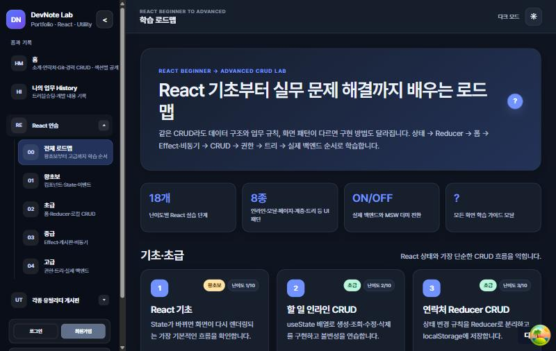
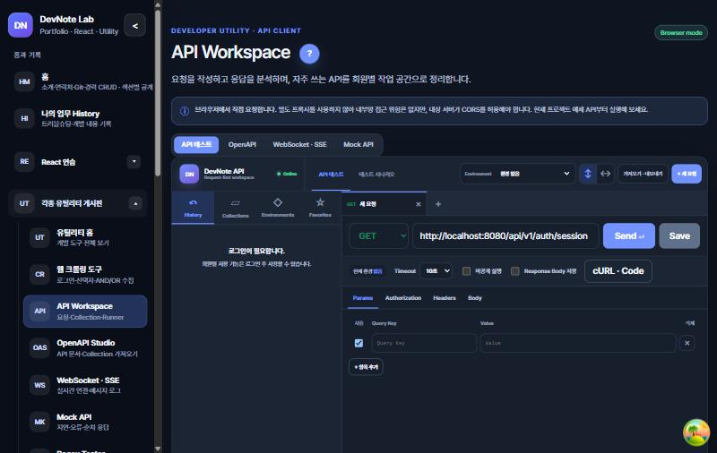

# DevNote 사용설명서

[문서 목록으로](../README.md) · [실행·설정 가이드](local-development.md) · [크롤러 상세 가이드](crawler.md) · [기능·학습 가이드](learning-guide.md)

이 문서는 사이트를 **사용하는 사람**을 위한 안내입니다. 설치 명령과 코드 구조를 모두 읽지 않아도, 화면에서 무엇을 눌러야 하는지 따라갈 수 있도록 작성했습니다. 각 기능 화면의 제목 옆 `?`를 누르면 해당 기능의 사용 순서와 주의사항을 팝업에서도 볼 수 있습니다. 화면과 문서를 대조한 기준일은 2026-10-05입니다. 버튼 이름이나 화면 구성이 이후 변경되었다면 실제 화면을 우선 확인해 주세요.

## 목차

1. [처음 실행하고 접속하기](#1-처음-실행하고-접속하기)
2. [화면 구성과 로그인](#2-화면-구성과-로그인)
3. [포트폴리오와 업무 History](#3-포트폴리오와-업무-history)
4. [React 학습 화면](#4-react-학습-화면)
5. [웹 크롤링 도구](#5-웹-크롤링-도구)
6. [API Workspace와 개발 도구](#6-api-workspace와-개발-도구)
7. [Diagram Designer와 관리자 화면](#7-diagram-designer와-관리자-화면)
8. [데이터 보관 위치와 주의사항](#8-데이터-보관-위치와-주의사항)
9. [문제가 생겼을 때](#9-문제가-생겼을-때)

## 1. 처음 실행하고 접속하기

이미 실행 중인 사이트를 사용한다면 이 절을 건너뛰고 [화면 구성과 로그인](#2-화면-구성과-로그인)부터 읽으면 됩니다.

### Docker로 처음 실행

1. Docker Desktop을 실행합니다.
2. 프로젝트 루트에서 PowerShell을 열고 아래 명령을 실행합니다. `.env`가 이미 있다면 덮어쓰지 않습니다.

   ```powershell
   if (-not (Test-Path .env)) { Copy-Item .env.example .env }
   docker compose up --build -d
   docker compose ps
   ```

3. `devnote-mysql`과 `devnote-backend`가 `healthy`, `devnote-frontend`가 `running`인지 확인합니다.
4. 브라우저에서 <http://localhost:3000>을 엽니다. 백엔드 상태는 <http://localhost:8080/actuator/health>에서 확인할 수 있습니다.

소스를 고치면서 사용하는 Windows 개발 환경은 저장소 루트의 `start-local-backend.cmd`를 실행한 뒤 <http://localhost:5173>에 접속합니다. 이 스크립트는 Docker 전체 앱을 종료하고 **별도 개발용 MySQL 볼륨**을 사용하므로, 3000 포트에서 보던 데이터가 5173 포트에서 자동으로 나타나지는 않습니다. 자세한 준비 과정은 [실행·설정 가이드](local-development.md#로컬-개발-실행-방법)를 참고하세요.

일반 종료는 `docker compose down`입니다. `docker compose down -v`는 DB와 업로드 파일 볼륨을 삭제하므로 데이터 초기화가 목적일 때만 사용하세요.

## 2. 화면 구성과 로그인

데스크톱에서는 왼쪽 사이드바, 모바일에서는 햄버거 버튼으로 메뉴를 엽니다. 주요 메뉴는 다음과 같습니다.

| 메뉴 | 주로 하는 일 |
|---|---|
| 홈과 기록 | 포트폴리오 보기, 프로젝트 상세 보기, 업무 History 읽기 |
| React 연습 | 로드맵을 따라 단계별 CRUD와 React 개념 실습 |
| 각종 유틸리티 게시판 | 크롤링, API 요청, 데이터 변환, 다이어그램 등 사용 |
| 관리자 | 회원·등급·권한 계획·방문 통계 관리. 권한에 따라 표시 |

공개 화면은 로그인하지 않아도 볼 수 있습니다. 학습 화면 상단의 `?`에는 **사용 방법 → 학습 내용 → 소스 흐름 → 실습 과제** 탭이 있고, 유틸리티의 `?`에는 해당 도구의 도움말이 있습니다. 라이트/다크 모드와 사이드바 접힘 상태는 현재 브라우저에 기억됩니다.

### 로그인과 회원가입

1. 사이드바의 `로그인` 또는 `회원가입`을 누릅니다.
2. 아이디와 비밀번호를 입력합니다. 회원가입을 하면 바로 로그인됩니다.
3. 로그인 모달의 `아이디 기억`은 **아이디만** 브라우저에 저장합니다. `자동 로그인`은 비밀번호를 저장하는 기능이 아니라 서버 세션을 최대 30일 유지하는 옵션입니다. 로그아웃하면 자동 로그인은 해제됩니다.

로컬에 새로 만든 DB의 초기 슈퍼관리자 계정은 `admin / admin1234`입니다. 개발 환경에서만 사용하고 외부에 공개하기 전에는 반드시 초기 비밀번호 해시를 바꾸세요. 이미 생성된 DB는 `.env` 값만 바꿔도 기존 관리자 비밀번호가 자동 변경되지는 않습니다. [배포 가이드](deployment.md#5-관리자-비밀번호-해시-생성--건너뛰지-마세요)를 참고하세요.

| 사용자 | 가능한 작업의 예 |
|---|---|
| 방문자 | 공개 포트폴리오·History 읽기, React 실습과 공개 유틸리티 사용 |
| 로그인 회원 | 회원별 Snippet·API Workspace 저장 기능, 투표 생성 등 사용 |
| `ADMIN` | 관리자 메뉴 조회, 투표 관리, 방문 통계 확인 |
| `SUPER_ADMIN` | 포트폴리오·History 편집, 회원·등급·권한 계획 변경 |

메뉴가 보이는 것과 실제 권한은 별개이며 서버가 최종 확인합니다. `권한관리` 화면의 토글은 현재 **표시용 계획**으로 저장되며 실제 접근 규칙을 바꾸지 않습니다.

## 3. 포트폴리오와 업무 History

### 포트폴리오 둘러보기

1. 사이드바에서 `홈`을 엽니다.
2. 소개·경력·기술·프로젝트 등 공개 블록을 아래로 내려가며 봅니다.
3. 프로젝트 카드의 `자세히 보기`를 누르면 기술 스택, 담당 역할, 저장소·데모 링크와 전체 설명을 볼 수 있습니다.
4. `PDF로 저장`은 브라우저 인쇄 창을 엽니다. 대상 프린터를 **PDF로 저장**으로 선택하면 인쇄용 화면을 파일로 받을 수 있습니다. PDF 파일을 서버에 저장하는 기능은 아닙니다.

슈퍼관리자로 로그인하면 `+ 블록 추가` 또는 블록 사이의 `+`를 눌러 종류를 고르고 내용을 입력할 수 있습니다. 빈 입력칸에 커서가 있지 않을 때 `/` 키로 블록 선택창을 열 수도 있습니다. 각 블록에서 수정·복제·삭제·공개/비공개를 선택하고, `↑`·`↓` 또는 드래그 핸들로 순서를 바꿉니다. **작성·수정 대화상자의 저장 버튼을 누르기 전에는 해당 편집 내용이 저장되지 않습니다.** 이미지 업로드 후에는 블록 저장까지 완료했는지 확인하세요.

### 업무 History 읽고 작성하기

1. `나의 업무 History`에서 제목·본문 검색, 상태·정렬, 태그 버튼으로 글을 찾습니다. 검색 조건은 주소에 반영되어 링크로 다시 열 수 있습니다.
2. 글을 열면 본문, 대표 이미지, 첨부파일을 볼 수 있습니다. 방문자는 발행된 글만 봅니다.
3. 슈퍼관리자는 `History 작성`을 누르고 제목, 상태(`임시저장`·`발행`·`보관`), 태그, 본문을 입력합니다. 태그는 쉼표로 나누며 최대 10개입니다.
4. 대표 이미지나 첨부파일을 선택하고 `문서 등록`을 누릅니다. 본문에는 이미지를 붙여넣거나 끌어다 놓을 수도 있습니다.
5. 기존 글의 `수정`에서는 필요하면 `변경 요약`을 입력하고 `수정 저장`을 누릅니다. 다른 창에서 먼저 수정했다면 버전 충돌(409)이 날 수 있습니다. 이때 상세 화면을 다시 불러와 최신 내용을 확인하세요.

`React 연습 → 문서·이미지 게시판`은 같은 문서 편집 흐름을 연습하는 별도 화면입니다. 작업 중 메뉴를 이동하기 전에 저장 여부를 직접 확인하세요. 현재 문서 편집기는 브라우저 탭을 닫거나 새로고침할 때 경고할 수 있지만, **사이트 내부 메뉴 이동을 모두 막아 주지는 않습니다.**

## 4. React 학습 화면

`React 연습 → 전체 로드맵`에서 왕초보·초급·중급·고급·심화 단계로 이동합니다. 각 실습 화면의 `?`를 열어 먼저 **사용 방법**을 읽고, 실제로 추가·수정·삭제를 해 본 다음 **소스 흐름**을 보는 순서를 권장합니다.



처음이라면 `/react/fundamentals`에서 State와 이벤트를 살펴보고, `/react/todos`에서 로컬 CRUD, `/react/documents`에서 실제 API·MySQL 문서 CRUD를 비교해 보세요. 뒤쪽에는 무한 스크롤, 동적 폼, Context 인증, React 19 Actions, Zustand, URL 상태, Suspense, 테스트 작성 실습이 있습니다. 전체 25단계와 각 단계의 저장 위치는 [기능·학습 가이드의 로드맵](learning-guide.md#난이도별-crud-학습-로드맵)에 정리했습니다. 초급·중급 목록과 전체 로드맵 아래에는 게임 규칙 함수 하나를 편집기에서 완성하는 [게임 규칙 직접 만들어 보기](learning-guide.md#게임-규칙-직접-만들어-보기react-연습) 연습 5개도 있습니다.

PC에 아무것도 설치하지 않고 연습하려면 화면 제목 옆 `▶ 직접 해 보기`를 누릅니다. `이 화면 아래에서 바로 편집`은 연습 화면 맨 아래 `직접 해 보기` 영역을 펼쳐 그 단계 연습 예제를 고쳐 바로 실행하고(그 영역 제목을 눌러 직접 펼치고 접어도 됩니다. `색 테마`에서 편집기·미리보기 배경과 글자 색을, `크게 보기`로 창 전체를, 상자 오른쪽 아래 `◢`를 끌어 상자 너비·높이를, 가운데·아래 막대를 끌어 안쪽 좌우 비율과 높이를 바꿀 수 있습니다), `StackBlitz에서 실제 코드 열기`는 실제 프로젝트 코드를 새 탭에서 실행하며(더미 데이터), `Codespaces에서 전체 실행`은 GitHub 로그인 후 백엔드·MySQL까지 실행합니다. 자세한 차이는 [기능·학습 가이드](learning-guide.md#직접-해-보기-사이트-안-편집기--stackblitz--codespaces)에 있습니다.

끝낸 단계는 로드맵 카드의 `완료 표시`나 `?` 대화상자 아래의 `이 단계 완료로 표시`로 기록하면 로드맵 위쪽 진행률이 올라갑니다. `실습 과제` 탭에서는 과제마다 체크할 수 있고, 막히면 `힌트 보기`를 펼쳐 어느 파일·함수부터 보면 되는지 확인합니다. 진도는 지금 쓰는 브라우저에만 저장되므로 다른 기기나 시크릿 창에서는 보이지 않습니다.

사이드바 하단의 `더미 데이터 ON/OFF`는 **문서 화면의 API 응답**을 실제 Spring Boot와 MSW 더미 응답 사이에서 바꿉니다. 전환 시 화면이 새로고침됩니다. 할 일·상품·댓글 같은 앞 단계는 React 상태 학습용이므로 더미 스위치를 껐다고 자동으로 MySQL에 저장되지는 않습니다. `더미 데이터 ON`에서 만든 문서와 실제 DB 문서를 혼동하지 마세요.

## 5. 웹 크롤링 도구

`각종 유틸리티 게시판 → 웹 크롤링 도구`(`/utilities/crawler`)는 Playwright Chromium으로 **사용자가 수집 권한을 가진 페이지**를 열고 데이터를 읽는 도구입니다. 사이트 차단이나 캡차를 우회하지 않습니다. 처음에는 로그인 없는 허용된 페이지에서 1페이지·소수 항목으로 시험하고, 결과를 확인한 뒤 범위를 늘리세요.

### 새 설정을 만들고 실행하기

1. 처음 보이는 `크롤링 설정 게시판`에서 `+ 새 설정`을 누릅니다. 저장해 둔 항목은 이 목록에서 `열기·수정`으로 다시 엽니다.
2. `설정 제목`과 `수집할 URL`을 입력합니다. 빨간 `*`가 붙은 필수값이 비어 있으면 저장·실행할 때 해당 칸으로 이동합니다.
3. `실행 방식`은 새 작업이라면 `단계별 실행`을 선택합니다. `기존 설정 방식`은 이전에 저장한 로그인·검색 설정과의 호환을 위해 남아 있습니다.
4. 단계 편집기의 왼쪽 `동작 추가`에서 `페이지 열기` → 필요한 `요소 클릭`·`텍스트 입력` → `목록 반복` 등을 추가합니다. 가운데 행을 누르면 아래에 선택한 단계의 설정이 나타납니다. 오른쪽 버튼으로 순서 변경·복사·삭제를 합니다.
5. `목록 반복`을 선택하고 `데이터 추출`을 추가하면 각 항목에서 읽을 열을 만들 수 있습니다. 예를 들어 이름은 `상품명`, 항목 내부 선택자는 `.product-title`, 추출할 값은 `텍스트`로 지정합니다. 링크 주소가 필요하면 `HTML 속성`의 `href`를 사용합니다.
6. 반복 항목 선택자와 수집 필드를 비우면 표·목록과 열 제목을 자동으로 찾습니다. 자동 감지가 다른 목록을 고르면 실제 페이지의 CSS 선택자로 직접 지정하세요. 일반 페이지는 `콘텐츠 iframe 선택자`를 비우고, iframe 안의 목록일 때만 채웁니다.
7. 먼저 `▷ 테스트 실행`으로 확인합니다. 테스트 요청은 최대 1페이지·3건으로 제한되지만, **직접 추가한 페이지 이동 단계는 그대로 실행**됩니다. 결과가 맞으면 `현재 설정 등록` 또는 `현재 설정 수정`으로 저장하고 정식 실행합니다.

`크롤링 실행`은 현재 입력값으로 바로 실행합니다. **저장된 설정을 선택한 상태에서** `#번호 설정 실행 · 이력 저장`을 사용하면 성공 결과나 실패 원인을 실행 이력에서 다시 볼 수 있습니다. 설정을 삭제하면 연결된 이력도 함께 삭제되므로 확인창 내용을 읽으세요.

처음 쓰는 CSS 선택자는 대상 페이지에서 개발자 도구의 **요소 검사**로 원하는 부분을 누른 뒤 찾습니다. `id="topLayerQueryInput"`인 입력칸은 `#topLayerQueryInput`, `class="product-title"`인 제목은 `.product-title`, 표의 각 행은 `table tbody tr`처럼 적습니다. `반복 항목 선택자`는 **한 건 전체**, `항목 안에서 찾을 선택자`는 **그 한 건 안의 제목·가격 등**을 가리켜야 합니다. 브라우저 개발자 도구에서 선택자가 여러 건을 찾는지 먼저 확인하고, 사이트 구조가 바뀌면 수정하세요. 단계의 `대상 글자`는 화면의 글자로 찾는 다른 방식이므로 모든 클릭·입력 동작에 CSS 선택자가 필요한 것은 아닙니다.

### 선택자, 키워드, 결과 검색의 차이

| 위치 | 하는 일 | 예 |
|---|---|---|
| 단계의 `대상 글자` | 화면에 보이는 글자·라벨로 클릭/입력 대상을 찾음 | `검색`, `카페글 검색어 입력` |
| `CSS 선택자` | HTML의 id·class 등으로 요소를 지정 | `#topLayerQueryInput`, `.product-item` |
| `수집 단계 키워드 조건` | 항목을 읽은 직후 AND/OR로 **수집 결과에 담을지** 결정 | 그룹 1 `LH` AND 그룹 2 `신림, 봉천`(OR) |
| 결과의 `전체 빠른 검색`·`+ 검색 조건` | 이미 수집한 결과 표를 **브라우저에서 다시 거르기** | `보증금(만원)` 숫자 이상, `월세(만원)` 숫자 이하 |

키워드는 예시일 뿐 하드코딩된 조건이 아닙니다. 그룹 안은 `모두 포함(AND)` 또는 `하나 이상 포함(OR)`, 그룹 사이는 `모든 그룹 만족(AND)` 또는 `한 그룹 이상 만족(OR)`로 자유롭게 바꿉니다. 더 정교한 가격 범위는 먼저 해당 값을 별도 열로 추출한 뒤 결과의 숫자 조건을 두 개 추가해 거르세요. 결과 화면에서 조건을 바꾸는 것은 **대상 사이트에 추가 요청을 보내지 않습니다.**

### 녹화, 수동 처리, 이력, CSV

- `● 녹화로 만들기`는 열린 Chromium에서 사용자가 클릭·입력한 동작을 기록합니다. 마쳤으면 `■ 녹화 종료`를 누르고 `녹화 결과로 단계 바꾸기` 또는 `기존 단계 뒤에 붙이기`를 선택합니다. **녹화는 동작 기록**이며, 목록의 한 건에서 어떤 데이터를 뽑을지는 `목록 반복`·`데이터 추출` 단계나 공통 수집 설정에서 확인해야 합니다. 녹화 결과를 편집기에 가져온 뒤 설정 게시글로 저장하세요. 서버 재시작 전까지 가져오지 않은 녹화 단계는 사라질 수 있습니다.
- 실행 중 단계가 막히면 화면·실패 이유를 보고 `계속(직접 처리함)`·`다시 시도`·`건너뛰기`·`중단`을 선택할 수 있습니다. 캡차·2단계 인증은 사용자가 직접 처리해야 하며, 통과 후 이어서 실행할 수 있습니다. 자동으로 로그인 성공을 보장하지 않습니다.
- `브라우저 동작 화면 보기`는 기본으로 켜져 있습니다. `웹 화면 안에서 보기` 또는 `내 PC에 새 창으로 열기`를 선택할 수 있습니다. Docker에서 PC 창을 쓰려면 먼저 `start-pc-chrome.cmd`가 필요합니다. 실패해도 화면은 잠시 남아 원인을 확인할 수 있습니다.
- 저장된 설정의 `실행 이력`에서 `결과 보기`와 `이전과 비교`를 누릅니다. 비교는 바로 이전 **성공** 실행을 기준으로 새 항목·사라진 항목을 보여 주며 대상 사이트에 재접속하지 않습니다.
- 결과의 `현재 결과 CSV`는 **지금 화면의 검색 조건으로 보이는 항목**을 내려받습니다. 파일명에는 다운로드 시점의 날짜·시간이 붙습니다. CSV를 엑셀에서 열 때 금액이나 층처럼 숫자로 보이는 값이 자동 변환되는지 원본 표와 대조하세요.

네이버 카페 등 로그인 사이트는 세션 만료·캡차·보호조치·화면 구조 변경으로 실패할 수 있습니다. 계정 아이디/비밀번호를 DB의 설정 게시글과 실행 이력에 저장하지 않지만, `아이디와 비밀번호 저장`을 켜면 **현재 브라우저 localStorage에 평문**으로 남습니다. 개인 기기에서만 사용하세요. 저장 세션은 로그인 쿠키가 든 파일이므로 외부에 공유하면 안 됩니다. 네이버 접근 제한을 피하는 확정적인 대기 시간은 없고, 상세글 수집은 항목마다 추가 페이지를 엽니다. 자세한 세션 설정, 실패 단계 해석, 요청 제한은 [크롤러 상세 가이드](crawler.md)에 있습니다.

## 6. API Workspace와 개발 도구

### API Workspace에서 요청 보내기

1. `/utilities/api-workspace`를 열고 `+ 새 요청`을 누릅니다.
2. HTTP 메서드와 URL을 고릅니다. 필요하면 요청 편집기의 Query Parameter, Header, 인증, Body를 설정합니다.
3. 요청을 전송하고 응답 상태 코드·시간·Header·Body를 확인합니다. `Actual Request`에서 환경변수 치환 뒤 실제 전송 값을 확인할 수 있습니다.
4. 로그인한 회원은 요청을 Collection·Folder에 `Save`하고 History에서 다시 열 수 있습니다. 상단 `Environment`를 만들거나 선택해 URL 등에 `{{baseUrl}}` 같은 변수를 쓸 수 있습니다.
5. 여러 저장 요청을 순서대로 시험하려면 상단 `테스트 시나리오`에서 Collection Runner를 엽니다. Postman 파일은 `가져오기 · 내보내기`에서 이동합니다.



이 도구는 **브라우저가 대상 API에 직접 요청**하므로 대상 서버의 CORS 정책이 적용됩니다. CORS 오류는 요청 JSON을 바꾸는 것만으로 해결되지 않을 수 있습니다. History·Collection·Environment는 서버 DB가 아니라 로그인 회원별 **현재 브라우저 저장소**에 있고 다른 기기로 자동 동기화되지 않습니다. 비회원은 열린 요청 탭만 보관합니다. Secret 환경변수·선택한 파일·민감한 인증값은 저장되지 않거나 가려지므로 다시 실행할 때 재입력해야 합니다. 예약 Runner도 서버 백그라운드 작업이 아니라 브라우저가 열려 있을 때 동작합니다. 세부 제한은 [기능·학습 가이드의 API Workspace](learning-guide.md#api-workspace)를 보세요.

### 다른 유틸리티 고르기

`유틸리티 홈`에서는 할 일에 맞는 카드를 골라 이동할 수 있습니다.

| 하고 싶은 일 | 추천 화면 |
|---|---|
| JSON을 CSV로 바꾸거나 CSV를 JSON으로 읽기 | `JSON ↔ CSV` |
| JSON·YAML·XML을 바꾸거나 DTO 초안 만들기 | `Data Converter` |
| 긴 JSON에서 필요한 경로와 값 찾기 | `JSONPath Explorer` |
| 정규식으로 검색·치환하고 Java/JavaScript 결과 비교 | `Regex Tester` |
| 코드 정리, 두 버전 차이 보기 | `Code Formatter`, `SQL Formatter`(키워드 정렬·들여쓰기 1~10칸·테이블/칼럼 코멘트 주석·Java 출력), `Code Diff` |
| Markdown 작성·미리보기, JWT 내용 확인 | `Markdown Editor`, `JWT Decoder` |
| 테스트용 행 생성, Cron 식 만들기 | `Test Data Generator`, `Cron Generator` |
| 코드 조각을 회원별로 저장·검색 | `Developer Snippet` |
| 주제 투표 만들고 참여하기 | `투표` |
| WebSocket/SSE·Mock API·CORS·로그 분석 | 유틸리티 홈의 해당 도구 카드 |

대부분의 변환·분석 도구는 입력을 서버에 저장하지 않습니다. `JWT Decoder`는 내용을 **디코딩**할 뿐 서명을 검증하지 않으므로 토큰이 진짜인지 판단하는 용도로 쓰면 안 됩니다. `Developer Snippet`은 로그인 회원별로 MySQL에 저장합니다. `투표`는 로그인 회원이 만들고 방문자도 참여할 수 있습니다. 각 도구의 정확한 저장 위치와 한도는 [기능·학습 가이드의 전체 목록](learning-guide.md#개발-유틸리티-전체-목록)을 참고하세요.

### 게임

사이드바의 `각종 유틸리티 게시판` 아래 `게임` 메뉴(`/games`)에는 `게임 홈`·`온라인 대전`·`게임 랭킹`이 있습니다. 예전의 혼자 하는 게임 화면(카드 짝 맞추기·2048·지뢰 찾기·테트리스, `/games/memory`·`/games/2048`·`/games/minesweeper`·`/games/tetris`)은 없앴고, 옛 주소로 들어오면 온라인 대전 대기실로 옮겨 갑니다.

- **게임 규칙 직접 만들어 보기**: 게임 화면 아래에 있던 편집기 연습은 `React 연습`으로 옮겼습니다. 사이드바 `React 연습 → 초급`(카드 섞기·2048 한 줄 밀기·스도쿠 숫자 놓기 검사)·`중급`(테트리스 줄 지우기·지뢰 찾기 빈 칸 연쇄 열기) 목록 아래, 또는 `전체 로드맵` 아래의 `게임 규칙 직접 만들어 보기` 카드에서 `연습 시작`을 누릅니다. 연습 화면 아래 `… 직접 만들어 보기`를 펼쳐 핵심 함수 하나를 완성하면 채점표가 ✅로 바뀝니다. 편집기는 따로 실행되어 실제 게임에는 영향이 없습니다. 게임 홈에서도 다섯 연습으로 바로 갈 수 있습니다.

### 온라인 대전

`게임 → 온라인 대전`(`/games/online`)에서 다른 사람과 실시간으로 겨룹니다. **백엔드 서버가 켜져 있어야** 합니다(더미 데이터 모드에서는 동작하지 않음).

1. **방 만들기**: `새 방 만들기`에서 제목·게임(오목 2인, 테트리스 대전 2~6인, 뿌요뿌요 대전 2~6인, 숫자 야구 2~4인, 배틀십 2인, 카드 짝 맞추기 대전 2~4인, 원카드 2~4인, 블랙잭 1~4인, 섯다 2~4인, 포커 2~4인, 체스 2인, 마피아 4~8인, 스도쿠 2~4인, 2048 대전 2~4인, 지뢰 찾기 대전 2~4인, 당구 1~2인, 올림픽 1~4인, 윷놀이 2~4인, 캐치마인드 2~8인, 장기 2인, 알까기 2인)·플레이어 수·게임 옵션(스도쿠 난이도, 2048 목표 타일, 지뢰 찾기 난이도, 뿌요뿌요 색 수, 당구 종목, 섯다 2장·3장, 윷놀이 말 개수, 캐치마인드 한 사람당 그리는 횟수, 알까기 정석·커스텀처럼 옵션이 있는 게임만)·비밀번호(선택, 4~20자)·`로그인 유저만 참가`(로그인했을 때만 켤 수 있음)를 정하고 `만들고 들어가기`를 누릅니다. 방을 만든 사람이 방장입니다. 게임 목록은 `혼자 연습 가능`(기다리는 동안 혼자 연습할 수 있는 게임) 묶음이 위에, `대전 전용` 묶음이 아래에 있습니다.
2. **들어가기**: 방 목록의 `들어가기`를 누릅니다. 로그인하지 않았으면 닉네임(2~12자)을, 비밀번호 방이면 비밀번호를 입력합니다(5번 틀리면 연결이 끊깁니다).
3. **플레이어와 관전자**: 들어오면 관전자입니다. 빈 자리의 `앉기`를 누르면 플레이어가 되고, `일어나서 관전하기`로 다시 관전자가 됩니다. 방에는 관전자 포함 10명까지 들어옵니다. 게임 중에는 자리를 바꿀 수 없습니다.
4. **시작 전 혼자 연습하기**: 테트리스·뿌요뿌요·카드 짝 맞추기·2048·지뢰 찾기·스도쿠·올림픽 방에서는 대기 중에 `… 연습하기`를 누르면 그 게임을 혼자 할 수 있습니다. 오목·체스·마피아처럼 상대가 필요한 게임과, 규칙이 서버에만 있는 블랙잭은 연습이 없습니다. 방장이 `게임 시작`을 누르면 연습은 닫힙니다. 끝난 연습 판은 `연습 기록 올리기`로 랭킹에 올릴 수 있습니다(브라우저가 계산한 기록이라 대전 승패와 따로 모읍니다).
5. **시작**: 자리가 모두 차면 방장이 `게임 시작`을 누릅니다.
   - 오목: 흑(0번 자리)부터 번갈아 두며, 가로·세로·대각선으로 5개 이상 이으면 이깁니다.
   - 테트리스 대전: 왼쪽에 내 판(보관·다음·방해 줄 게이지), 오른쪽에 다른 플레이어 판이 보입니다. 모두 같은 순서의 블록으로 시작합니다. 2줄을 지우면 1줄, 3줄은 2줄, 4줄은 4줄의 회색 방해 줄이 다음 상대에게 갑니다. 더 쌓을 곳이 없으면 탈락하고, 마지막까지 남은 사람이 1위입니다. 일시정지는 없습니다.
   - 뿌요뿌요 대전: 테트리스와 같이 각자 브라우저가 규칙을 계산하고 서버는 같은 시드·판 요약·공격·탈락만 중계합니다. 6×12 판에 색 뿌요 두 개가 한 쌍으로 떨어지고(방 옵션 3·4·5색, 처음 값 4색), 같은 색 4개가 이어지면 터지며 붙어 있는 회색 방해 뿌요도 사라집니다. 연쇄 점수÷70만큼 방해 뿌요가 다음 상대에게 갑니다. 더 쌓을 곳이 없으면 탈락하고, 마지막까지 남은 사람이 1위입니다. 일시정지는 없습니다.
   - 숫자 야구: 각자 서로 다른 숫자 3개를 몰래 정하고, 돌아가며 다음 사람의 숫자를 맞힙니다. 숫자와 자리가 맞으면 S(스트라이크), 숫자만 맞으면 B(볼), 하나도 없으면 OUT. 3S를 낸 사람이 나오면 그 바퀴가 끝날 때 승리합니다.
   - 배틀십: 10×10 바다에 배 5척(5·4·3·3·2칸)을 무작위로 배치하고(`다시 배치`로 바꾸기, 마음에 들면 `준비 완료`), 번갈아 상대 바다를 눌러 쏩니다. o 빗나감·X 명중, 배의 모든 칸이 맞으면 격침되고 모두 격침하면 승리합니다. 내 배는 나에게만 보이고 끝나면 모두 공개됩니다.
   - 카드 짝 맞추기 대전: 한 판의 카드(2인 8쌍·3인 10쌍·4인 12쌍)를 돌아가며 두 장씩 뒤집습니다. 같은 그림이면 내 짝이 되고 한 번 더, 틀리면 다음 사람 차례이며 틀린 두 장은 다음 사람이 뒤집을 때까지 보입니다. 가장 많이 맞힌 사람이 이깁니다.
   - 원카드: 7장씩 받고 맨 위 카드와 무늬나 숫자가 같은 카드를 냅니다(낼 수 있는 카드만 밝게 보임). A +3·2 +2·흑백 조커 +5·컬러 조커 +7 공격은 A·2·조커로 막아 쌓거나 받기로 모두 받습니다. 7은 무늬 바꾸기, J 건너뛰기, Q 순서 거꾸로, K 한 번 더. 낼 카드가 없으면 `한 장 받기`. 먼저 다 낸 순서로 순위가 매겨지고 20장 이상이면 파산합니다.
   - 블랙잭: 각자 가상 칩 1000개로 딜러와 5판을 겨룹니다. 판마다 10칩 이상 걸고, 받기(HIT)·멈추기(STAND)·더블(처음 두 장일 때 베팅 2배로 한 장만)을 고릅니다. 21을 넘으면 버스트, 처음 두 장이 21이면 블랙잭(1.5배). 딜러는 17 이상이 될 때까지 받습니다. 5판 뒤 칩이 가장 많은 사람이 이깁니다.
   - 섯다: 가상 칩 1000개로 6판. 판마다 10칩을 내고 화투를 받아 체크·콜·레이즈·다이로 베팅하고, 끝까지 남은 사람 중 족보가 높은 사람이 판돈을 가져갑니다(38광땡 > 광땡 > 땡 > 알리·독사·구삥·장삥·장사·세륙 > 끗). 암행어사는 광땡, 땡잡이는 1~9땡을 잡고, 구사·멍텅구리구사는 다시 합니다. 한 바퀴에 올릴 수 있는 칩은 남은 사람 중 가장 적은 칩까지입니다.
     - 게임 옵션: `2장 섯다`(처음 값)는 두 장으로 한 번 베팅합니다. `3장 섯다`는 두 장으로 첫 베팅 → 남은 사람만 한 장 더 → 세 가지 조합 버튼(족보 이름 표시) 중 보여 줄 두 장을 고름 → 마지막 베팅 → 고른 두 장으로 비교합니다. 고른 패는 판이 끝날 때까지 남에게 보이지 않고 "두 장 고름"만 보입니다.
     - 화면 왼쪽에 전체 족보표(예시 화투 그림)가 있고, 지금 내 패의 족보가 표에서 강조되며 `내 패` 옆에도 이름이 나옵니다. 구사(4월·9월, 두 장이 모두 열끗은 아님)와 멍텅구리구사(4월 열끗 두견새 + 9월 열끗 술잔)는 그림으로 구분됩니다.
     - 화투 그림: 위키미디어 공용 Mliu92 작품(CC BY-SA 4.0). 출처는 족보표 아래에 표시됩니다.
   - 장기: 0번 자리가 초(먼저·아래), 1번 자리가 한(위)입니다. 시작하면 각자 마·상 위치(상차림: 마상마상·상마상마·마상상마·상마마상)를 고르고, 둘 다 고르면 대국이 시작됩니다. 내 기물을 누르면 갈 수 있는 점에 파란 점이 찍히고, 그 점을 누르면 둡니다(궁성 대각선, 포 넘기, 마·상 길막힘 모두 서버가 판단). 장군을 막을 수 없으면 외통으로 집니다. 장군이 아닐 때는 `한 수 쉬기`를 할 수 있고, 둘이 연달아 쉬거나 200수가 되면 남은 기물 점수(차 13·포 7·마 5·상 3·사 3·졸 2, 한 덤 1.5)로 승패를 정합니다. 빅장·같은 수 반복 규칙은 없습니다. 한은 판이 돌려 보입니다.
   - 알까기: 바둑판 위에서 흑(아래·먼저)과 백(위)이 번갈아 알을 튕깁니다. 게임 옵션으로 두 가지 방식 중 하나를 고릅니다.
     - `정석`(처음 값): 알 8개씩 자기 쪽 한 줄에 같은 간격으로 놓인 채 바로 시작합니다.
     - `커스텀 · 최대 4/6/8/10개`: 시작하면 배치 단계입니다. 내 쪽 절반(흑 = 아래, 백 = 위, 밝게 표시. 가운데 빨간 점선 줄은 어느 쪽도 아님)의 교차점을 눌러 알을 놓고, 놓은 알을 다시 누르면 뺍니다. 키보드로는 `칸`·`줄` 번호를 넣고 `놓기·빼기`를 누릅니다. 1개 이상 놓았으면 `배치 완료`(이후 변경 불가). 두 사람이 모두 완료할 때까지 상대 배치는 보이지 않고 놓은 개수만 보입니다(관전자도 볼 수 없음). 둘 다 완료하면 흑부터 튕깁니다. 정해진 개수보다 적게 놓아도 됩니다. 내 알을 누른 채 반대쪽으로 끌어당겼다 놓으면(새총) 당긴 거리만큼 세게 날아갑니다. 키보드로는 아래 `내 알`·`각도`·`힘`을 정해 `튕기기`를 누릅니다. 알의 움직임(마찰·충돌·판 밖으로 떨어짐)은 서버가 계산하고 모두 같은 궤적을 봅니다. 상대 알만 떨어뜨리면 한 번 더 튕기고, 상대 알을 모두 떨어뜨리면 이깁니다(60번 튕기면 남은 알 수로 결정).
   - 포커(텍사스 홀덤): 가상 칩 1000개로 6판. 블라인드 10/20을 내고 내 카드 2장을 받은 뒤, 공용 카드가 플랍(3장)·턴(1장)·리버(1장)로 열릴 때마다 체크·콜·레이즈·폴드로 베팅합니다. 끝까지 남으면 내 2장 + 공용 5장 중 가장 좋은 5장(로열 플러시 ~ 하이카드)으로 겨룹니다.
   - 체스: 0번 자리가 백(먼저), 1번 자리가 흑입니다. 내 기물을 누르면 갈 수 있는 칸에 점이 찍히고, 그 칸을 누르면 둡니다. 캐슬링·앙파상·프로모션(퀸·룩·비숍·나이트 중 선택)을 지원하며, 체크메이트하면 이깁니다. 스테일메이트·50수 규칙·같은 국면 3번 반복·기물 부족은 무승부입니다. 흑은 판이 뒤집혀 보입니다.
   - 마피아: 서버가 직업(마피아 1~2명·경찰·의사(5명 이상)·시민)을 몰래 나눠 줍니다. 밤에는 마피아가 지목, 의사가 살릴 사람, 경찰이 조사할 사람을 고르고, 낮에는 채팅으로 이야기한 뒤 모두 투표(건너뛰기 가능)해 가장 많이 받은 한 명을 처형합니다. 마피아가 모두 죽으면 시민 팀, 마피아 수가 나머지와 같아지면 마피아 팀이 이깁니다. 탈락하면 게임이 끝날 때까지 채팅할 수 없고, 직업은 게임이 끝나면 모두 공개됩니다.
   - 스도쿠: 모두 같은 문제(9×9 판, 답은 하나. 게임 옵션 난이도에 따라 숫자 40개 쉬움·32개 보통·26개 어려움이 놓임)를 받아 각자 자기 판을 동시에 채웁니다. 칸을 누르거나 방향키로 고르고 숫자 버튼·키보드 1~9로 넣으며, `지우기`·Backspace로 지웁니다. 처음부터 놓인 숫자는 그냥 숫자로, 내가 넣은 숫자는 동그라미 안에 보여 구분됩니다. 같은 줄·상자에 겹치는 숫자는 빨갛게 보이고, 틀린 숫자를 넣어도 벌점은 없습니다. 가장 먼저 정답을 완성한 사람이 바로 이깁니다. 남의 판은 보이지 않고 채운 칸 수만 막대로 보이며, 끝나면 정답이 공개되어 틀린 숫자(빨간 줄)와 못 채운 칸(흐린 정답)을 확인할 수 있습니다.
   - 2048 대전: 모두 같은 4×4 판에서 시작하고 새 타일도 모두 같은 순서로 나옵니다. 방향키·W·A·S·D, 화면 버튼, 판 위에서 밀기로 움직이며 밀어도 판이 그대로인 방향은 이동으로 치지 않습니다. 게임 옵션의 목표 타일(256·512·1024·2048, 처음 값 512)을 만들면 성공, 더 밀 수 없으면 실패입니다. 성공한 사람은 이동 수가 적은 순(같으면 먼저 끝낸 순), 실패한 사람은 점수가 높은 순으로 순위가 매겨지고 1위가 이깁니다(같은 기록이면 공동 1위). 왼쪽에 내 판, 오른쪽에 다른 사람의 판이 점수·이동 수와 함께 보입니다.
   - 지뢰 찾기 대전: 게임 옵션 난이도(초급 9×9 지뢰 10·중급 16×16 지뢰 40·고급 16×30 지뢰 99, 처음 값 초급)의 같은 지뢰 배치를 각자 자기 판에서 풉니다. 시작할 때 모든 판에 같은 빈 영역이 미리 열려 있습니다. 누르기·Enter·Space = 열기, 열린 숫자 누르기 = 주변 깃발 수가 맞으면 나머지 열기, 오른쪽 클릭·F·깃발 모드 = 깃발, 방향키 = 칸 이동입니다. 지뢰를 밟으면 실패, 지뢰가 아닌 칸을 모두 열면 성공이며, 성공은 클릭 수(판을 바꾼 열기만 셈)가 적은 순, 실패는 연 칸이 많은 순입니다. 지뢰 위치는 게임이 끝날 때까지 아무에게도 보내지 않고, 끝나면 지뢰·밟은 지뢰·틀린 깃발이 공개됩니다.
   - 당구: 게임 옵션으로 종목(3쿠션·4구·8볼 포켓, 처음 값 3쿠션)을 고르는 3D 당구입니다. 1명 방이면 혼자 연습합니다. 내 차례에 당구대를 왼쪽 버튼(한 손가락)으로 끌거나 `조준 각도`로 방향을, `힘`으로 세기를, 당점 원(또는 `밀어치기`·`끌어치기`·`왼쪽/오른쪽 회전`)으로 공의 어디를 칠지 고른 뒤 `치기`(스페이스)를 누릅니다. 흰 점선은 처음 닿을 곳까지의 예상 경로, 노란 선은 맞은 공이 나갈 방향, 파란 선은 수구가 갈라질 방향입니다(회전은 넣지 않은 직선 예상). 시점은 `위에서`·`수구 뒤에서`·`자유 시점`(오른쪽 버튼·두 손가락으로 회전, 휠로 확대)으로 바꿉니다.
     - 3쿠션: 내 공(0번 자리 흰 공, 1번 자리 노란 공)으로 두 공을 모두 맞히되 두 번째 공 전에 쿠션 3번 이상이면 1점. 4구: 빨간 공 둘을 맞히면 1점, 상대 공을 맞히면 1점 잃음. 둘 다 득점하면 계속 치고 먼저 10점이면 승리(30이닝이면 점수로 결정).
     - 8볼: 처음 넣은 공으로 솔리드(1~7)·스트라이프(9~15)가 정해지고, 내 무리를 다 넣은 뒤 8번을 넣으면 승리합니다. 파울(수구가 빠짐·아무것도 못 맞힘·남의 무리를 먼저 맞힘·맞힌 뒤 쿠션도 넣은 공도 없음)이면 상대가 `수구 옮기기`로 원하는 곳에 놓고 칩니다. 무리를 다 넣기 전에 8번을 넣으면 집니다.
     - 공의 움직임(미끄러짐→구름, 당점 회전, 쿠션 반사, 공끼리 충돌)은 서버가 계산하고, 모두가 같은 궤적을 3D로 재생해 봅니다. WebGL을 쓸 수 없는 브라우저에서는 당구대가 보이지 않습니다.
   - 윷놀이: 게임 옵션으로 말 개수(4개·2개 빠른 판, 처음 값 4개)를 고릅니다. 내 차례에 `윷 던지기`를 누르면 서버가 윷을 던집니다(도 1칸·개 2칸·걸 3칸·윷 4칸·모 5칸, 빽도는 없음). 윷·모가 나오면 한 번 더 던지고, 모아 둔 결과는 아래 이동 버튼(예: `걸: 새 말 → 3번 칸`)으로 하나씩 씁니다. 버튼에 마우스를 올리거나 Tab으로 가면 판에서 출발·도착 칸이 노랗게 보입니다. 모서리(5·10번 칸)나 가운데 방에 딱 멈추면 다음 차례에 지름길로 갑니다. 상대 말이 있는 칸에 멈추면 그 말을 처음으로 돌려보내고 한 번 더 던지며, 내 말끼리 같은 칸에 모이면 업혀서 함께 움직입니다. 출발점(오른쪽 아래)을 지나 말을 모두 먼저 내보내면 이깁니다.
   - 캐치마인드: 자리 순서대로 돌아가며 출제자가 되어(게임 옵션: 한 사람당 1~3번, 처음 값 2번) 제시어를 그림판에 그립니다. 출제자에게만 제시어가 보이고, 다른 사람에게는 글자 수(예: ○○ (2글자))만 보입니다. 출제자는 펜 색 8가지(흰색은 지우개)·굵기 4단계·`되돌리기`·`모두 지우기`·`넘기기`를 쓸 수 있고, 차례 동안 채팅은 막힙니다. 다른 사람은 `정답` 칸에 답을 적어 `맞히기`를 누릅니다(띄어쓰기는 무시). 가장 먼저 맞힌 사람 +10점, 출제자 +5점이고 바로 다음 그림으로 넘어갑니다. 틀린 답은 모두에게 보입니다. 모든 차례가 끝나면 점수가 가장 높은 사람이 이깁니다(아무도 점수가 없으면 무승부). 시간제한은 없으니 아무도 못 맞히면 출제자가 `넘기기`를 누릅니다.
   - 올림픽: 육상 6종목(100m 달리기·110m 허들·멀리뛰기·창던지기·해머던지기·높이뛰기) 대회입니다. 게임이 시작되면 1번 선수가 이번 대회 종목을 고르고(전 종목·달리기만·뛰기만·던지기만 버튼으로 빠르게), 고른 순서대로 각자 경기합니다. 1명 방이면 혼자 대회입니다.
     - 조작: ←·→(또는 Z·X)를 번갈아 빠르게 눌러 달립니다(같은 쪽을 연달아 누르면 비틀거림). 스페이스(또는 ↑·주황 버튼)는 허들 점프·해머 놓기이고, 멀리뛰기·창던지기·높이뛰기에서는 누른 채 각도를 올리고 떼면 뛰거나 던집니다(멀리뛰기 약 20°, 창 약 40°, 높이뛰기 약 65~70°가 좋음). 터치 화면에서는 아래 버튼을 씁니다.
     - 규칙: 100m는 신호 전에 누르면 부정 출발(두 번이면 실격), 허들에 걸리면 크게 느려집니다. 멀리뛰기·창던지기는 선을 넘으면 파울, 3번 시도 중 최고 기록. 해머는 10초 안에 해머가 초록 부채꼴 쪽(노랗게 빛날 때)에서 놓아야 합니다. 높이뛰기는 1.70m부터 5cm씩 올라가며 한 높이에서 3번 실패하면 끝납니다.
     - 메달: 2명 이상이면 종목마다 순위대로 금·은·동(같은 기록은 같은 메달), 혼자면 기준 기록을 넘으면 메달입니다. 모두 결과를 확인(`다음 종목`)하면 넘어가고, 금 → 은 → 동 개수로 우승을 정합니다. 달리기 종목에서는 다른 선수가 옆 레인에서 함께 달립니다.
   - 2048·지뢰 찾기 대전에서 먼저 성공·실패한 사람은 다른 사람이 끝날 때까지 지켜보며, 그 뒤 기권하거나 나가도 정해진 결과로 기록됩니다. 아직 하던 중에 기권하거나 나가면 맨 아래 순위이고 이길 수 없습니다. 나머지가 모두 빠지면 남은 사람이 바로 이깁니다.
6. **방 정보 수정**(방장): 제목·비밀번호(그대로/바꾸기/해제)·로그인 유저만 참가는 언제든, 게임 종류·인원 수·게임 옵션은 게임 중이 아닐 때 바꿉니다. 대기 중에는 판 아래 `게임 옵션` 칸에서 옵션만 바로 바꿀 수도 있고, 다른 사람에게는 방 이름 아래에 `게임 옵션: …`으로 보입니다. 게임 종류를 바꾸면 옵션은 그 게임의 처음 값으로 돌아갑니다. 인원을 줄이면 앞 번호 자리 사람이 남고 넘치는 사람은 관전자가 됩니다.
7. **채팅**: 플레이어와 관전자 모두 쓸 수 있습니다(200자, 1초에 2개까지). 방장이 나가면 먼저 들어온 사람이 방장이 됩니다.

방·자리·채팅은 서버 메모리에만 있고 저장되지 않습니다. 사람이 없는 방은 1분 뒤 사라지고, 서버를 다시 켜면 모든 방이 없어집니다. 게임 승패만 랭킹용으로 MySQL에 저장됩니다(아래 게임 랭킹).

### 게임 랭킹

`게임 → 게임 랭킹`(`/games/rankings`)에서 종목마다 순위를 봅니다. **백엔드 서버가 켜져 있어야** 합니다.

- **종목·난이도**: `종목`에서 온라인 대전 21종과 혼자 하는 게임 6종 중 하나를 고릅니다. 지뢰 찾기·카드 짝 맞추기·스도쿠는 난이도마다 따로 매깁니다. 혼자 하는 게임 기록은 온라인 대전 방에서 기다리는 동안 연습한 뒤 `연습 기록 올리기`로 올립니다. `… 하러 가기`는 온라인 대전 대기실로 안내합니다.
- **기간**: 처음에는 `이번 달`(1일~말일)이 보입니다. `이번 주`(월~일)·`이번 달`·`전체` 버튼을 누르면 바로 바뀌고, 시작일·종료일을 직접 고를 수도 있습니다. 날짜는 한국 날짜 기준이며 종료일 하루 전체를 포함합니다.
- **온라인 대전 순위**: 게임이 끝나면 서버가 승패를 자동으로 기록합니다. 승수가 많은 순, 같으면 승률이 높은 순입니다. 무승부는 판 수에만 들어가고, 기권하거나 나간 사람은 이긴 팀(마피아 등)이어도 패배로 기록됩니다(단, 2048·지뢰 찾기 대전에서 먼저 성공·실패로 결과가 정해진 뒤 나간 사람은 그 결과대로 기록). 혼자 한 판(블랙잭 1인)과 한 회원이 두 자리에 앉은 판은 기록하지 않습니다.
- **혼자 하는 게임 순위**: 이미 올린 기록을 사람마다 기간 안의 가장 좋은 기록 하나로 줄 세웁니다(2048·테트리스·뿌요뿌요는 점수, 지뢰 찾기·스도쿠는 시간, 카드 짝 맞추기는 시도 → 시간).
- **회원과 비회원**: 로그인했으면 회원 이름으로, 아니면 닉네임(2~12자, 온라인 대전과 같은 값)으로 기록됩니다. 같은 닉네임의 비회원 기록은 같은 사람으로 묶이고 `비회원` 표시가 붙습니다. **비회원 기록은 1주일이 지나면 지워집니다**(1시간마다 정리).
- 혼자 하는 게임 점수는 브라우저가 계산해 보내므로 서버는 값의 범위만 확인합니다. 학습용 랭킹이라 조작을 완전히 막지는 못합니다.

## 7. Diagram Designer와 관리자 화면

### 다이어그램 만들기

1. `/utilities/diagrams`에서 `새 다이어그램`을 누릅니다.
2. 빈 캔버스에서 `테이블 추가`를 누르거나, 아래 `SQL 연동`에 `CREATE TABLE` DDL을 붙여 넣고 `SQL → ERD`를 누릅니다.
3. 테이블 위치와 연결을 다듬은 뒤 `저장`을 누릅니다. 저장하지 않은 변경이 있으면 버튼에 `*`가 붙습니다.
4. 필요하면 `ERD → DDL`, `PNG 내보내기`, `SVG 내보내기`를 사용합니다. 저장된 버전은 `버전 이력`에서 되돌릴 수 있습니다.

저장된 이력은 내용이 실제로 바뀔 때만 남고 최근 30개까지 보관됩니다. 현재는 테이블명·컬럼을 캔버스에서 직접 편집하는 UI가 없으므로 구조 변경은 SQL을 다시 가져오는 방식입니다. [Diagram Designer 상세 문서](diagram-designer.md)를 참고하세요.

### 관리자 메뉴

`ADMIN` 이상이면 회원·등급·권한 계획·방문 통계 화면의 조회 권한이 나타납니다. 회원 정보와 등급·권한 계획을 **변경**하려면 `SUPER_ADMIN`이 필요합니다. 특히 `권한관리` 토글을 바꿔도 실제 API 권한은 바뀌지 않습니다. 운영 권한 설정으로 착각하지 마세요.

## 8. 데이터 보관 위치와 주의사항

| 데이터 | 보관 위치 | 주의할 점 |
|---|---|---|
| 포트폴리오·History·문서·첨부·Snippet·투표·다이어그램 | MySQL 및 업로드 파일 볼륨 | DB와 파일을 함께 백업. `docker compose down -v`는 볼륨 삭제 |
| 크롤러 설정·실행 이력 | MySQL | 설정 삭제 시 연결 이력도 삭제. 로그인 아이디·비밀번호는 여기 저장하지 않음 |
| 네이버 로그인 세션 | 서버의 `.local/crawler-sessions/` | 로그인 쿠키가 있어 비밀번호처럼 보호해야 함 |
| API Workspace의 History·Collection·Environment | 회원별 브라우저 localStorage | 다른 브라우저와 자동 동기화되지 않음. Secret은 재입력 필요 |
| 크롤러의 `아이디와 비밀번호 저장` 옵션 | 현재 브라우저 localStorage에 평문 | 공용 PC에서 사용하지 말 것 |
| 테마·사이드바·일부 연습 상태 | 현재 브라우저 저장소 | 브라우저 데이터 삭제 시 초기화될 수 있음 |
| 게임 최고 기록 | 현재 브라우저 localStorage(`devnote.games.*`) | 다른 기기·브라우저와 공유되지 않음 |
| 온라인 대전 방·자리·채팅 | 백엔드 서버 메모리 | 저장하지 않음. 빈 방은 1분 뒤, 서버 재시작 시 모두 사라짐. 비회원 닉네임만 브라우저 localStorage |
| 게임 랭킹 기록(온라인 승패·혼자 하는 게임 기록) | MySQL(`online_game_results`·`solo_game_records`) | 회원 기록은 계속 보관, 비회원 기록은 1주일 뒤 자동 삭제 |

외부에 공개하는 서버라면 초기 관리자 비밀번호, HTTPS 세션 쿠키, 크롤러 API 접근 범위 등 [공개 전 체크리스트](deployment.md#12-외부-공개-전-체크리스트)를 먼저 검토하세요.

## 9. 문제가 생겼을 때

| 증상 | 먼저 확인할 것 |
|---|---|
| `Port 8080 was already in use` | 이미 실행 중인 백엔드·Docker 컨테이너가 있는지 확인. 하나만 사용하거나 백엔드 포트와 Vite 프록시를 함께 변경 |
| 화면은 열리는데 저장·목록 조회가 실패 | <http://localhost:8080/actuator/health>와 `docker compose ps`, `docker compose logs backend` 확인. 5173 개발 화면은 별도 백엔드 8080이 필요 |
| 3000과 5173의 데이터가 다름 | Docker 전체 앱 DB와 `start-local-backend.cmd`의 개발 DB가 서로 다른 볼륨인지 확인 |
| 문서 저장 후 409 | 다른 창의 수정과 충돌. 최신 상세 내용을 다시 확인한 뒤 수정 |
| 크롤러가 빈 결과를 반환 | 실패 단계·입력값·실행 로그 확인. URL, 로그인 상태, 목록/필드 선택자, iframe, 키워드 조건과 최대 페이지를 순서대로 점검 |
| 네이버 로그인·수집 중단 | 캡차·추가 인증·계정 보호조치·세션 만료 여부를 화면에서 직접 확인. 자동 우회나 안전한 요청 간격은 제공하지 않음 |
| API Workspace의 외부 요청만 실패 | 브라우저 개발자 도구의 CORS 오류와 대상 서버의 허용 Origin 확인. 필요하면 같은 서버의 API로 먼저 시험 |
| 저장한 API 요청의 Token·파일이 비어 있음 | 민감값과 파일은 저장하지 않으므로 다시 입력·선택 |
| CSV의 금액·층 값이 이상하게 보임 | 결과 웹 표와 원본 CSV를 대조하고 스프레드시트의 자동 숫자 변환 여부 확인 |

더 자세한 원인·로그 확인 명령은 [실행·설정 가이드의 자주 발생하는 문제](local-development.md#자주-발생하는-문제), 실제 해결 사례는 [트러블슈팅 사례](troubleshooting.md)를 참고하세요. 재현 가능한 오류를 보고할 때는 **화면 주소, 누른 버튼, 입력값 중 비밀이 아닌 부분, 화면의 오류 코드·추적 번호, 백엔드 로그 시각**을 함께 남기면 확인이 빠릅니다. 크롤러의 실패 상세에는 비밀번호가 그대로 포함될 수 있으므로 공유 전 반드시 지우세요.
